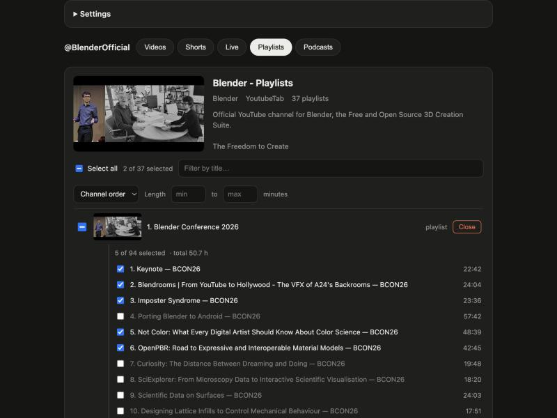

# YouTube Videos Downloader

A small local web interface for [yt-dlp](https://github.com/yt-dlp/yt-dlp). Paste a video, playlist or channel link, see what's in it, tick what you want and download it, neatly organised into folders.

Two files, no frameworks, no build step: a Python server (`app.py`, standard library only) and one HTML page (`index.html`).



## Features

- **Look before you download.** Title, thumbnail, channel, length, views, upload date and the best available quality.
- **Playlists and channels.** Every video appears as a checklist. Paste a channel link to get tabs for Videos, Shorts, Live, Playlists and Podcasts.
- **Expand playlists in place.** Open any playlist on a channel and pick individual videos without leaving the list.
- **Find things fast.** Filter by title or by length (e.g. 30–45 minutes), and sort by order, length, views or title.
- **Quick selection.** Select all (respects filters) and shift-click to select a range.
- **Formats.** Best quality, 2160p down to 480p (mp4), or audio only (mp3 / m4a).
- **Organised output.** `Channel/Playlist/Video title [id].mp4`, with optional length folders (`30min/`, `45min/`, ...) rounded to the nearest 5 minutes.
- **Skip what you already have.** Finished downloads are remembered, so re-checking a channel only fetches new videos.
- **Download queue.** Three downloads run at a time, with progress, cancel, retry and clear.
- **Extras.** Embedded thumbnail, chapters and metadata, plus optional subtitles in the languages you choose.
- **Maintenance.** An "Update yt-dlp" button and a folder picker for where downloads go.

## Requirements

- Python 3.8+
- [yt-dlp](https://github.com/yt-dlp/yt-dlp#installation) and [ffmpeg](https://ffmpeg.org/download.html) on your `PATH`

```bash
# macOS
brew install yt-dlp ffmpeg

# Windows
winget install yt-dlp.yt-dlp Gyan.FFmpeg

# Linux (Debian/Ubuntu)
sudo apt install ffmpeg && python3 -m pip install -U yt-dlp
```

## Run it

```bash
git clone https://github.com/tcctr/youtube-videos-downloader.git
cd youtube-videos-downloader
python3 app.py
```

Your browser opens at <http://localhost:8765>. Use `python3 app.py --no-browser` to skip that. On macOS you can also double-click `start.command` in Finder.

The server only listens on `127.0.0.1`, so it isn't reachable from other devices on your network.

## Settings

Open **Settings** at the top of the page. Your choices are saved to `settings.json` next to `app.py`, which is ignored by git.

| Setting | Default |
|---|---|
| Download folder | `~/Downloads/yt-dlp` |
| Channel / Playlist folders | on |
| Length folders | off |
| Skip already downloaded | on (tracked in `.downloaded.txt` inside the download folder) |
| Embed thumbnail, chapters, info | on |
| Subtitles | off (`en.*`) |

## Please download responsibly

This is a front end for yt-dlp. Only download content you have the right to download, such as your own uploads, Creative Commons or public-domain videos, or material the owner allows you to save. Respect the terms of service of the sites you use.

## License

[MIT](LICENSE)
